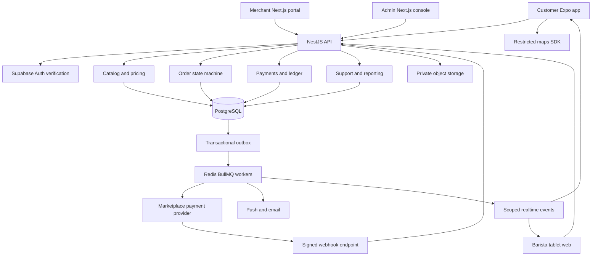

# System architecture

Use one API and one database initially; queues for durable asynchronous processing, not source of truth. Keep external calls outside DB transactions. Realtime sends invalidation/version events, then clients fetch authorized data.
